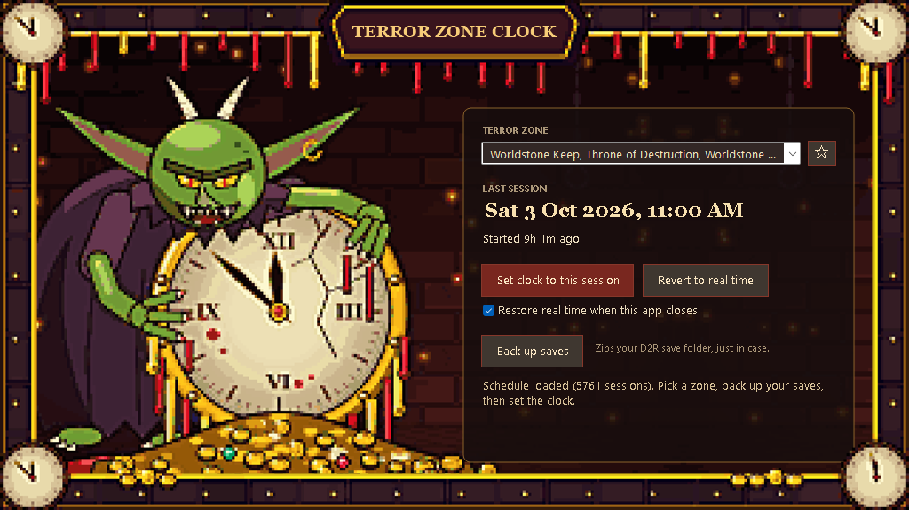

# D2R Terror Zone Clock

A small Windows app that sets your PC clock to a chosen Diablo II: Resurrected terror zone session, then puts the real time back when you're done.



In single-player and offline D2R, the active terror zone follows a fixed schedule based on your PC's clock. Pick the zone you want, and the app moves the Windows clock to the start of that zone's most recent session.

## Features

- Pick any terror zone. Favourite zones (☆) stay at the top of the list.
- See the zone's last session in your local time. If the schedule has no earlier session for that zone, you see the next one instead.
- Set the clock to that session with one click. The app asks you to confirm first.
- Back up your D2R save folder to a zip before you change anything.
- Revert to the real time, fetched from `time.windows.com`.
- Restore the real time automatically when the app closes (on by default).
- Keeps working offline with the last schedule it downloaded.

## Download and run

1. Download `D2RTerrorZoneClock-vX.Y.Z.zip` from the [Releases](../../releases) page.
2. Extract the zip into a folder.
3. Run `D2RTerrorZoneClock.exe`.

Windows asks for administrator permission each time you start the app, because changing the system clock requires it.

The exe isn't code-signed, so Windows SmartScreen may show "Windows protected your PC" the first time. Click **More info**, then **Run anyway**. The checksum for each zip is listed on its release page if you want to verify the download.

### Requirements

- Windows 10 or 11 (the .NET Framework 4.x it needs is built in).
- Internet access to download the schedule and look up the real time. After one successful download, the app can use the saved schedule offline.

## Back up your saves first

Changing the system clock is usually harmless, but if something goes wrong you'll want a copy of your characters. Click **Back up saves** before setting the clock.

- The app zips everything in `Saved Games\Diablo II Resurrected`, including mod folders.
- Backups go to `Saved Games\Diablo II Resurrected Backups`, named by date and time, for example `D2R saves 2026-10-03 19-45-12.zip`.
- To restore, close D2R, then copy the files from the backup zip back into `Saved Games\Diablo II Resurrected`, replacing the existing ones.

While your clock is shifted, websites may show certificate errors and some apps may behave oddly. Revert to the real time when you've finished playing.

## Settings and data

Settings, favourites and the cached schedule are stored in `%LOCALAPPDATA%\D2RTerrorZoneClock`. To remove the app completely, delete that folder and the folder you extracted the zip into. Save backups stay where they are until you delete them.

## Building from source

No SDK needed. The build uses the C# compiler that ships with Windows, and the artwork in `assets\` is embedded in the exe.

```powershell
# Build calendar-publish\D2RTerrorZoneClock.exe
powershell -ExecutionPolicy Bypass -File build.ps1

# Build and package dist\D2RTerrorZoneClock-v<version>.zip plus a .sha256 file
powershell -ExecutionPolicy Bypass -File release.ps1
```

To cut a new version, update the three version attributes at the top of `CalendarTimeTool.cs` before running `release.ps1`.

`Program.cs` and `SetSystemTime.csproj` are the older command-line clock setter. They aren't part of this build.

## Credits

The terror zone schedule comes from [d2emu.com](https://d2emu.com/tz-sp).

This is a fan-made tool, not affiliated with or endorsed by Blizzard Entertainment. Diablo is a trademark of Blizzard Entertainment, Inc.

## Licence

[MIT](LICENSE)
